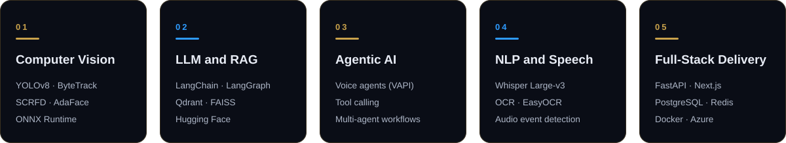
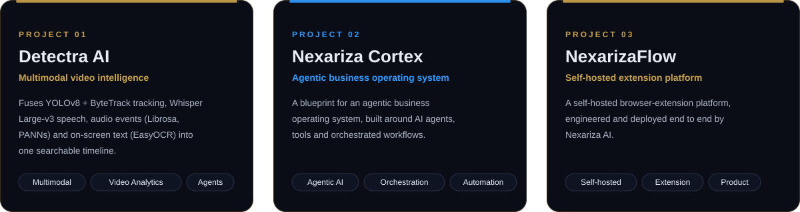
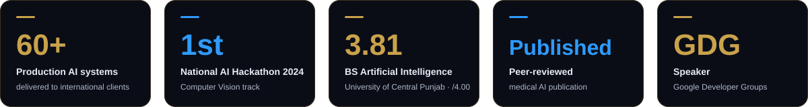

<!--
╔══════════════════════════════════════════════════════════════════════════════╗
║  NEXARIZA AI · GITHUB PROFILE README                                         ║
║  Intelligent Systems · AI Engineering · Automation · Computer Vision         ║
║                                                                              ║
║  Recommended repository structure:                                           ║
║  .                                                                           ║
║  ├── README.md                                                               ║
║  └── assets/                                                                 ║
║      ├── banner.svg                                                          ║
║      ├── credentials.svg                                                     ║
║      ├── expertise.svg                                                       ║
║      ├── projects.svg                                                        ║
║      └── divider.svg                                                         ║
╚══════════════════════════════════════════════════════════════════════════════╝
-->

<div align="center">

<!-- ═════════════════════════════════ HERO ═════════════════════════════════ -->



<br/>


<br/><br/>

[](https://github.com/nexariza-ai)
&nbsp;&nbsp;
[](https://github.com/nexariza-ai)
&nbsp;&nbsp;
[](https://nexariza.com)

</div>

<br/>

<!-- ══════════════════════════════ IDENTITY ══════════════════════════════════ -->

<div align="center">

# NEXARIZA AI

### **We engineer intelligence that works.**

<p>
Nexariza AI is an AI engineering company building <strong>intelligent systems, AI employees,
automation platforms, and production-grade computer vision solutions</strong> for modern organizations.
</p>

<p>
From <strong>model architecture → orchestration → APIs → infrastructure → deployment → measurable outcomes</strong>.
</p>

<br/>

<a href="https://nexariza.com">
  
</a>
&nbsp;
<a href="https://nexariza.com/contact">
  
</a>

</div>

<br/>


<br/>

<!-- ═════════════════════════════ MISSION ═══════════════════════════════════ -->

## ◈ The Nexariza Mission

> **Turn difficult business problems into intelligent, reliable, deployable systems.**

We believe AI should not stop at a notebook, prototype, or impressive demo.

Our work is designed around the full engineering lifecycle:

```text
PROBLEM
   ↓
DISCOVERY
   ↓
SYSTEM DESIGN
   ↓
DATA + MODELS
   ↓
AGENT / WORKFLOW ORCHESTRATION
   ↓
API + PRODUCT ENGINEERING
   ↓
DEPLOYMENT + OBSERVABILITY
   ↓
MEASURABLE BUSINESS OUTCOME
```

<div align="center">

| ◆ | What we optimize for | ◆ |
|:---:|:---|:---:|
| **01** | Intelligence that solves a real problem | |
| **02** | Systems that remain maintainable after launch | |
| **03** | Automation that removes repetitive work | |
| **04** | Interfaces that make advanced AI usable | |
| **05** | Production reliability, speed, and scalability | |

</div>

<br/>

<!-- ═════════════════════════════ CAPABILITIES ══════════════════════════════ -->

<div align="center">



</div>

<br/>

### AI Systems

Design and engineering of production-ready AI systems across structured, unstructured, visual, conversational, and multimodal data.

`Machine Learning` · `Deep Learning` · `Generative AI` · `Multimodal AI` · `LLM Systems`

### Intelligent Agents & Automation

Workflow-driven AI that can reason, use tools, retrieve information, coordinate actions, and operate across business processes.

`AI Agents` · `Multi-Agent Systems` · `RAG` · `LangGraph` · `LangChain` · `Tool Calling` · `Workflow Automation`

### Computer Vision

Real-world visual intelligence for detection, recognition, tracking, analysis, inspection, and monitoring.

`Object Detection` · `Face Recognition` · `Video Analytics` · `OCR` · `Tracking` · `Segmentation`

### AI Product Engineering

From a model or idea to an accessible product with APIs, dashboards, authentication, data layers, infrastructure, and deployment.

`FastAPI` · `React` · `Next.js` · `PostgreSQL` · `Redis` · `Docker` · `Cloud`

<br/>


<br/>

<!-- ═══════════════════════════ TECHNOLOGY STACK ═════════════════════════════ -->

## ◈ Technology Architecture

<div align="center">

### Intelligence Layer


<br/><br/>

`OpenAI` &nbsp;·&nbsp; `Claude` &nbsp;·&nbsp; `Gemini` &nbsp;·&nbsp; `Hugging Face` &nbsp;·&nbsp; `scikit-learn`

<br/><br/>

### Agentic & Retrieval Layer

`LangChain` &nbsp;·&nbsp; `LangGraph` &nbsp;·&nbsp; `RAG` &nbsp;·&nbsp; `FAISS` &nbsp;·&nbsp; `Qdrant`

<br/><br/>

### Vision & Multimodal Layer

`YOLOv8` &nbsp;·&nbsp; `ByteTrack` &nbsp;·&nbsp; `ONNX Runtime` &nbsp;·&nbsp; `Whisper` &nbsp;·&nbsp; `AdaFace` &nbsp;·&nbsp; `SCRFD`

<br/><br/>

### Product & Infrastructure Layer


</div>

<br/>


<br/>

<!-- ═════════════════════════════ SYSTEM DESIGN ═════════════════════════════ -->

## ◈ How We Build

<div align="center">

```text
┌──────────────────────────────────────────────────────────────────────────────┐
│                         NEXARIZA AI SYSTEM MODEL                              │
├───────────────────┬───────────────────┬───────────────────┬──────────────────┤
│   DATA & CONTEXT  │     INTELLIGENCE  │   ORCHESTRATION   │     DELIVERY     │
│                   │                   │                   │                  │
│ • Documents      │ • ML / DL         │ • Agents          │ • APIs           │
│ • Images         │ • LLMs            │ • Workflows       │ • Dashboards     │
│ • Video          │ • Vision          │ • RAG             │ • Web Apps       │
│ • Audio          │ • Multimodal      │ • Tool Calling    │ • Cloud          │
│ • Business Data  │ • Reasoning       │ • Memory          │ • Monitoring     │
└───────────────────┴───────────────────┴───────────────────┴──────────────────┘
                                   ↓
                         MEASURABLE OUTCOMES
```

</div>

We engineer the layers together rather than treating an AI model as the entire product.

<br/>

<!-- ═════════════════════════════ SELECTED WORK ══════════════════════════════ -->

<div align="center">



</div>

<br/>

### 01 · Detectra AI

**Deep Video Intelligence Platform**

A multimodal video-analysis architecture designed to combine visual events, audio/transcript context, intelligent retrieval, and agentic reasoning into timestamped intelligence.

`Multimodal AI` `Video Analytics` `Agents` `RAG` `Computer Vision`

---

### 02 · VisionGuard

**AI-Powered Visual Intelligence**

A product vision centered on real-time recognition, monitoring, and intelligent alerting using computer vision pipelines and AI inference.

`Computer Vision` `Detection` `Tracking` `Inference` `Real-Time AI`

---

### 03 · AI Student Platform

**ML Learning & Experimentation Workspace**

A full-stack environment for uploading datasets, selecting supervised or unsupervised learning workflows, training models, and exploring results through a guided interface.

`Next.js` `Python` `Flask` `Machine Learning` `Data Science`

---

### 04 · Bone AI

**Fracture Detection & Localization**

A computer-vision pipeline designed to classify X-ray imagery and identify fracture regions using deep-learning detection models.

`YOLO` `PyTorch` `Medical AI` `Object Detection` `ONNX`

<br/>


<br/>

<!-- ═════════════════════════════ NEXARIZA ══════════════════════════════════ -->

## ◈ About Nexariza AI

<div align="center">


<br/><br/>

**Nexariza AI** builds intelligent technology for organizations operating across

### **North America · Europe · GCC · Asia-Pacific**

</div>

Our focus is simple:

> **Build AI that moves from “interesting” to “useful.”**

We work across AI engineering, intelligent automation, computer vision, generative AI, AI product development, and full-stack systems.

<br/>

<div align="center">

🌐 **[nexariza.com](https://nexariza.com)**  
📩 **[contact@nexariza.com](mailto:contact@nexariza.com)**  
💬 **[WhatsApp](https://wa.me/923707348001)**

</div>

<br/>


<br/>

<!-- ═════════════════════════════ FOUNDER ════════════════════════════════════ -->

## ◈ Founder

<div align="center">


### **Ahmad Yasin**

**Founder & CEO — Nexariza AI**  
AI Engineer · AI Systems Architect

<p>
Building intelligent products across <strong>AI, machine learning, computer vision,
generative AI, agentic systems, and full-stack engineering</strong>.
</p>

<br/>

<a href="https://ahmadyasin.vercel.app">

</a>
&nbsp;
<a href="https://www.linkedin.com/in/ahmad-yasin1">

</a>
&nbsp;
<a href="https://www.upwork.com/freelancers/~013900a3c3552a40a6">

</a>
&nbsp;
<a href="https://www.fiverr.com/s/dDmlq9G">

</a>

</div>

<br/>



<br/>


<br/>

<!-- ═════════════════════════════ GITHUB SIGNAL ═════════════════════════════ -->

## ◈ Engineering Activity

<div align="center">


<br/><br/>


<br/><br/>


<br/>


</div>

<br/>


<br/>

<!-- ═════════════════════════════ OPEN COLLABORATION ════════════════════════ -->

<div align="center">

# ◈ Build Something Intelligent

<p>
Have a business problem that could be solved with AI?<br/>
Need a computer-vision pipeline, AI agent, automation system, or full-stack AI product?
</p>

<br/>

<a href="https://nexariza.com/contact">

</a>

&nbsp;&nbsp;&nbsp;

<a href="https://ahmadyasin.vercel.app">

</a>

<br/><br/>

<sub>
<strong>AI Engineering · Intelligent Automation · Computer Vision · Generative AI · Full-Stack AI</strong>
</sub>

</div>

<br/>


<br/>

<!-- ════════════════════════════ LINK DIRECTORY ══════════════════════════════ -->

<details>
<summary><strong>⌁ All Nexariza AI & Founder Links</strong></summary>

<br/>

<div align="center">

| Ecosystem | Link |
|:---|:---|
| 🌐 Nexariza AI | [nexariza.com](https://nexariza.com) |
| 💼 Nexariza LinkedIn | [linkedin.com/company/nexariza](https://www.linkedin.com/company/nexariza) |
| 📸 Nexariza Instagram | [@nexariza_ai](https://www.instagram.com/nexariza_ai/) |
| 📘 Nexariza Facebook | [facebook.com/nexariza](https://www.facebook.com/nexariza/) |
| 🎯 Nexariza Fiverr | [Fiverr](https://www.fiverr.com/s/dDmlq9G) |
| 🚀 Nexariza Contra | [Contra](https://contra.com/company/nexariza_ai_762ab8) |
| ▶️ Nexariza Learning Hub | [YouTube](https://www.youtube.com/@NexarizaLearningHub) |
| 🌐 Ahmad Yasin | [ahmadyasin.vercel.app](https://ahmadyasin.vercel.app) |
| 💼 Ahmad Yasin — LinkedIn | [linkedin.com/in/ahmad-yasin1](https://www.linkedin.com/in/ahmad-yasin1) |
| 💻 Ahmad Yasin — GitHub | [github.com/Ahmadyasin1](https://github.com/Ahmadyasin1) |
| 🤗 Ahmad Yasin — Hugging Face | [huggingface.co/AhmadYasin](https://huggingface.co/AhmadYasin) |
| 🧪 Ahmad Yasin — Kaggle | [kaggle.com/ahmadyasin1](https://www.kaggle.com/ahmadyasin1) |
| 🟢 Ahmad Yasin — Google Developers | [g.dev/ahmad-yasin](https://g.dev/ahmad-yasin) |
| ✍️ Ahmad Yasin — Medium | [medium.com/@mianahmadyasin](https://medium.com/@mianahmadyasin) |
| 📸 Ahmad Yasin — Instagram | [@mianahmadyasin](https://instagram.com/mianahmadyasin) |
| 💼 Ahmad Yasin — Upwork | [Upwork](https://www.upwork.com/freelancers/~013900a3c3552a40a6) |
| ✉️ Email | [contact@nexariza.com](mailto:contact@nexariza.com) |
| 💬 WhatsApp | [+92 370 7348001](https://wa.me/923707348001) |

</div>
</details>

<br/>

<!-- ═════════════════════════════ FOOTER ════════════════════════════════════ -->

<div align="center">

<sub>
<strong>NEXARIZA AI</strong> · Intelligent Systems for the Real World
</sub>

<br/><br/>

<a href="https://nexariza.com">

</a>

<br/><br/>

<sub>© Nexariza AI · AI Engineering · Intelligent Automation · Computer Vision · Generative AI</sub>

</div>
