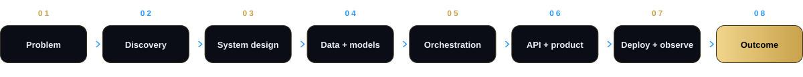
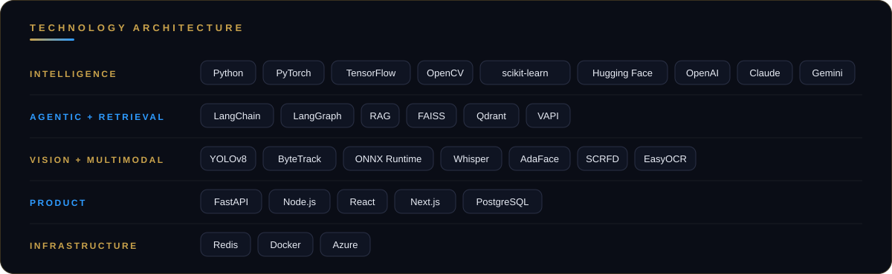
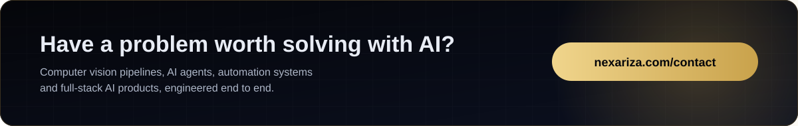

<!--
╔══════════════════════════════════════════════════════════════════════════════╗
║  NEXARIZA AI · GITHUB PROFILE README                                         ║
║                                                                              ║
║  Repository structure:                                                       ║
║  .                                                                           ║
║  ├── README.md                                                               ║
║  └── assets/                                                                 ║
║      ├── banner.svg        ├── projects.svg                                  ║
║      ├── credentials.svg   ├── stack.svg                                     ║
║      ├── expertise.svg     ├── cta.svg                                       ║
║      ├── process.svg       └── divider.svg                                   ║
║                                                                              ║
║  Logo and founder photo load from nexariza.com.                              ║
║  GitHub stat cards work for user accounts. If "nexariza-ai" is an            ║
║  organization, remove the "Engineering activity" section.                    ║
╚══════════════════════════════════════════════════════════════════════════════╝
-->

<div align="center">

<a href="https://nexariza.com"></a>


<h1>Nexariza AI · AI Engineering Company</h1>

<b>Production LLM, RAG, agentic AI and computer vision systems<br/>for organizations across North America, Europe, the GCC and Asia-Pacific.</b>

<br/><br/>

<a href="https://github.com/nexariza-ai"></a>
<a href="https://nexariza.com/contact"></a>
<a href="https://nexariza.com"></a>

<a href="https://www.linkedin.com/company/nexariza"></a>
<a href="https://www.instagram.com/nexariza_ai/"></a>
<a href="https://www.facebook.com/nexariza/"></a>
<a href="https://www.youtube.com/@NexarizaLearningHub"></a>

<a href="https://www.fiverr.com/s/dDmlq9G"></a>
<a href="https://contra.com/company/nexariza_ai_762ab8"></a>
<a href="mailto:contact@nexariza.com"></a>
<a href="https://wa.me/923707348001"></a>

<br/><br/>


<sub>🌐 <a href="https://nexariza.com">nexariza.com</a> &emsp;·&emsp; 📩 <a href="mailto:contact@nexariza.com">contact@nexariza.com</a> &emsp;·&emsp; 💬 <a href="https://wa.me/923707348001">+92 370 7348001</a></sub>


</div>

<div align="left">

## About Nexariza AI

**Nexariza AI** ([nexariza.com](https://nexariza.com)) is an AI engineering company that builds intelligent systems, AI employees and automation platforms. It designs and ships production AI end to end: from model architecture and inference pipelines to deployed, monitored products.

> **Turn difficult business problems into intelligent, reliable, deployable systems.**

**Core expertise:** computer vision (YOLOv8, ByteTrack, SCRFD, AdaFace, ONNX Runtime) · LLM and RAG systems (LangChain, LangGraph, Qdrant, Hugging Face) · agentic AI and voice agents (VAPI) · speech and NLP (Whisper) · full-stack deployment (FastAPI, Next.js, PostgreSQL, Docker, Azure).

**Founder track record:** 60+ production AI systems delivered to international clients · 1st place, National AI Hackathon 2024 (Computer Vision track) · BS Artificial Intelligence, University of Central Punjab (3.81/4.00) · peer-reviewed medical AI publication · speaker at Google Developer Groups.

</div>

<br/>

<div align="center">


</div>

## Founder

<table>
<tr>
<td align="center" width="230" valign="top">

<br/><br/>
<b>Ahmad Yasin</b>
<br/>
<sub>Founder &amp; CEO, Nexariza AI</sub>
<br/>
<sub>AI Engineer · AI Systems Architect</sub>
</td>
<td valign="top">
<br/>
<b>Ahmad Yasin</b> (GitHub: <a href="https://github.com/Ahmadyasin1">@Ahmadyasin1</a>) is an AI engineer and AI systems architect. He founded Nexariza AI to build production AI across <b>computer vision, large language models, retrieval-augmented generation (RAG), agentic automation and full-stack engineering</b>.
<br/><br/>
<a href="https://ahmadyasin.vercel.app"></a>
<a href="https://www.linkedin.com/in/ahmadyasin1"></a>
<a href="https://github.com/Ahmadyasin1"></a>
<a href="https://huggingface.co/AhmadYasin"></a>
<a href="https://www.kaggle.com/ahmadyasin1"></a>
<a href="https://www.upwork.com/freelancers/~013900a3c3552a40a6"></a>
<a href="https://medium.com/@mianahmadyasin"></a>
</td>
</tr>
</table>

<div align="center">


</div>

## What we build

<table>
<tr>
<td width="50%" valign="top">
<b>AI Systems</b><br/>
Production-ready AI across structured, unstructured, visual, conversational and multimodal data.<br/>
<sub><code>Machine Learning</code> · <code>Deep Learning</code> · <code>Generative AI</code> · <code>LLM Systems</code></sub>
</td>
<td width="50%" valign="top">
<b>Intelligent Agents and Automation</b><br/>
Workflow-driven AI that reasons, uses tools, retrieves information and coordinates actions across business processes.<br/>
<sub><code>AI Agents</code> · <code>RAG</code> · <code>LangGraph</code> · <code>Tool Calling</code> · <code>Voice Agents</code></sub>
</td>
</tr>
<tr>
<td width="50%" valign="top">
<b>Computer Vision</b><br/>
Real-world visual intelligence for detection, recognition, tracking, analysis, inspection and monitoring.<br/>
<sub><code>Object Detection</code> · <code>Face Recognition</code> · <code>Video Analytics</code> · <code>OCR</code> · <code>Tracking</code></sub>
</td>
<td width="50%" valign="top">
<b>AI Product Engineering</b><br/>
From a model or an idea to a usable product with APIs, dashboards, authentication, data layers, infrastructure and deployment.<br/>
<sub><code>FastAPI</code> · <code>React</code> · <code>Next.js</code> · <code>PostgreSQL</code> · <code>Docker</code> · <code>Azure</code></sub>
</td>
</tr>
</table>

<div align="center">

<br/>


<br/>


</div>

## How we build

We engineer every layer together, so the model is never mistaken for the whole product.

<div align="center">



</div>

<table>
<tr><td align="center"><b>01</b></td><td>Intelligence that solves a real problem</td></tr>
<tr><td align="center"><b>02</b></td><td>Systems that stay maintainable after launch</td></tr>
<tr><td align="center"><b>03</b></td><td>Automation that removes repetitive work</td></tr>
<tr><td align="center"><b>04</b></td><td>Interfaces that make advanced AI usable</td></tr>
<tr><td align="center"><b>05</b></td><td>Production reliability, speed and scalability</td></tr>
</table>

<div align="center">

<br/>


</div>

## Selected work

<div align="center">


</div>

### Detectra AI: how the pipeline fits together

Detectra AI is a multimodal video intelligence system that fuses object tracking, speech, audio events and on-screen text into one searchable timeline.

```text
                         VIDEO
                           │
      ┌──────────────┬─────┴────────┬──────────────┐
      ▼              ▼              ▼              ▼
 YOLOv8 +       Whisper        Librosa +       EasyOCR
 ByteTrack      Large-v3        PANNs         on-screen text
 objects        speech          audio events
 and tracks     transcript
      └──────────────┴──────┬───────┴──────────────┘
                            ▼
                one searchable timeline
```

### More work

| Project | What it is |
|:---|:---|
| **VisionGuard** | AI-powered visual intelligence: real-time recognition, monitoring and intelligent alerting built on computer vision pipelines and AI inference. |
| **AI Student Platform** | A full-stack ML learning workspace: upload datasets, pick supervised or unsupervised workflows, train models and explore results (Next.js, Python, Flask). |
| **Bone AI** | Fracture detection and localization: classifies X-ray imagery and identifies fracture regions with deep-learning detection models (YOLO, PyTorch, ONNX). |

<div align="center">

<br/>





</div>

## Engineering activity

<div align="center">




<a href="https://nexariza.com/contact"></a>&nbsp;
<a href="https://nexariza.com"></a>&nbsp;
<a href="https://ahmadyasin.vercel.app"></a>

</div>

<div align="left">

## Frequently asked questions

<details><summary><b>What is Nexariza AI?</b></summary>
<br/>Nexariza AI is an AI engineering company that builds intelligent systems, AI employees and automation platforms for organizations in North America, Europe, the GCC and Asia-Pacific. Website: <a href="https://nexariza.com">nexariza.com</a>.
</details>

<details><summary><b>Who founded Nexariza AI?</b></summary>
<br/>Nexariza AI was founded by Ahmad Yasin, an AI engineer and AI systems architect who serves as Founder &amp; CEO. Profiles: <a href="https://ahmadyasin.vercel.app">portfolio</a>, <a href="https://www.linkedin.com/in/ahmadyasin1">LinkedIn</a>, <a href="https://huggingface.co/AhmadYasin">Hugging Face</a>, <a href="https://www.kaggle.com/ahmadyasin1">Kaggle</a>.
</details>

<details><summary><b>What does Nexariza AI build?</b></summary>
<br/>Production AI in computer vision, large language models, retrieval-augmented generation (RAG), agentic automation, speech and NLP, delivered as full-stack products with APIs, dashboards, infrastructure and monitoring.
</details>

<details><summary><b>Which AI technologies does Nexariza AI work with?</b></summary>
<br/>Python, PyTorch, TensorFlow, OpenCV, YOLOv8, ByteTrack, ONNX Runtime, Whisper, LangChain, LangGraph, Qdrant, FAISS, Hugging Face, OpenAI, Claude, Gemini, VAPI, FastAPI, Node.js, React, Next.js, PostgreSQL, Redis, Docker and Azure.
</details>

<details><summary><b>What is Detectra AI?</b></summary>
<br/>Detectra AI is a multimodal video intelligence system. It fuses object tracking (YOLOv8, ByteTrack), speech recognition (Whisper Large-v3), audio events (Librosa, PANNs) and on-screen text (EasyOCR) into one searchable timeline.
</details>

<details><summary><b>How can I hire Nexariza AI?</b></summary>
<br/>Start a project at <a href="https://nexariza.com/contact">nexariza.com/contact</a>, email <a href="mailto:contact@nexariza.com">contact@nexariza.com</a>, message on <a href="https://wa.me/923707348001">WhatsApp</a>, or hire through <a href="https://www.fiverr.com/s/dDmlq9G">Fiverr</a> or <a href="https://contra.com/company/nexariza_ai_762ab8">Contra</a>.
</details>

</div>

<details>
<summary><sub>All profiles and links</sub></summary>
<br/>

| | Nexariza AI | | Ahmad Yasin (Founder) |
|:---:|:---|:---:|:---|
| 🌐 | [nexariza.com](https://nexariza.com) | 🌐 | [ahmadyasin.vercel.app](https://ahmadyasin.vercel.app) |
| 💼 | [Nexariza on LinkedIn](https://www.linkedin.com/company/nexariza) | 💼 | [linkedin.com/in/ahmadyasin1](https://www.linkedin.com/in/ahmadyasin1) |
| 📸 | [@nexariza_ai](https://www.instagram.com/nexariza_ai/) | 💻 | [github.com/Ahmadyasin1](https://github.com/Ahmadyasin1) |
| 📘 | [Nexariza on Facebook](https://www.facebook.com/nexariza/) | 🤗 | [huggingface.co/AhmadYasin](https://huggingface.co/AhmadYasin) |
| ▶️ | [Nexariza Learning Hub](https://www.youtube.com/@NexarizaLearningHub) | 🧪 | [kaggle.com/ahmadyasin1](https://www.kaggle.com/ahmadyasin1) |
| 🎯 | [Nexariza on Fiverr](https://www.fiverr.com/s/dDmlq9G) | 🟢 | [g.dev/ahmad-yasin](https://g.dev/ahmad-yasin) |
| 🚀 | [Nexariza on Contra](https://contra.com/company/nexariza_ai_762ab8) | ✍️ | [medium.com/@mianahmadyasin](https://medium.com/@mianahmadyasin) |
| 💻 | [github.com/nexariza-ai](https://github.com/nexariza-ai) | 📸 | [@mianahmadyasin](https://instagram.com/mianahmadyasin) |
| 📩 | [contact@nexariza.com](mailto:contact@nexariza.com) | 💼 | [Ahmad on Upwork](https://www.upwork.com/freelancers/~013900a3c3552a40a6) |
| 💬 | [WhatsApp](https://wa.me/923707348001) | | |

</details>

<div align="center">

<br/>

<sub><b>NEXARIZA AI</b> · Intelligent Systems for the Real World</sub>

<sub>AI Engineering · Intelligent Automation · Computer Vision · Generative AI · Full-Stack AI</sub>

</div>
